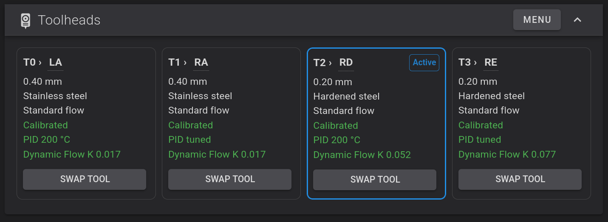
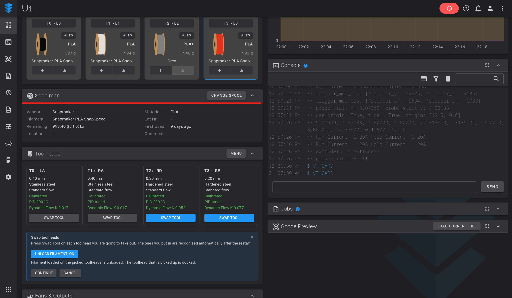
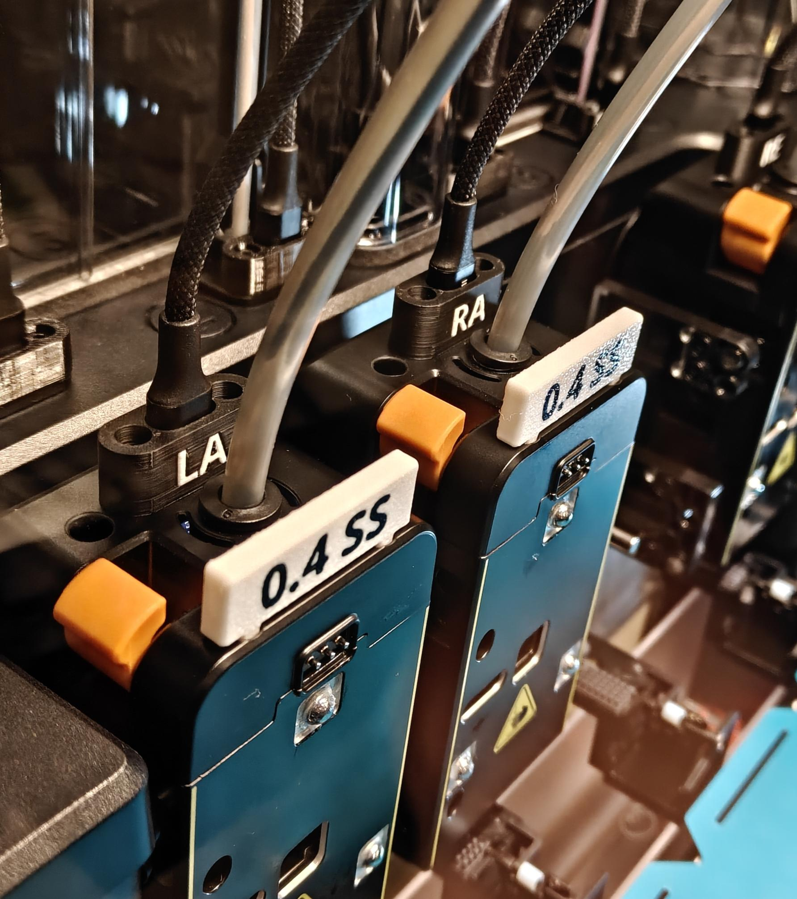

# Snapmaker U1 Extended Firmware + QuickSwap Virtual Toolheads



An unofficial fork of [paxx12's Snapmaker U1 Extended Firmware](https://github.com/paxx12-snapmaker-u1/SnapmakerU1-Extended-Firmware)
that adds **virtual toolheads**: calibration, nozzle, PID and flow data that
follow the *toolhead*, not the slot it happens to be plugged into.

> **Warning:** This is experimental, unofficial firmware. It is not affiliated
> with or endorsed by Snapmaker or paxx12. Damage caused by custom firmware is
> not covered by the Snapmaker warranty. Back up first, stay at the printer for
> your first calibrations, and use it at your own risk.

## Why

On a stock U1 changing a nozzle means taking a toolhead off the dock, opening 
it up, removing multiple screws, unplugging and unrouting several small wiring 
connections, then putting on the new nozzle, routing the wires back and closing
it all up.  Throughout this process you have to go into various menus to unload
filament, dock the toolhead, change to the new nozzle size, go to the calibration
screen, etc.  And even if you just replace one nozzle, doing so means 
recalibrating all four toolheads, a process that involves staying at the printer, 
waiting for each one in turn to heat up so you can scrub it, and finally removing 
the buildplate so it can run offset calibration.

It's not hard, but a simple nozzle change could take 30 minutes or more of work 
and baby-sitting.  And that's enough to make me not end up doing a print.

With quickswap virtual toolheads, each physical toolhead is a named object that 
remembers its own data, so you can keep spares, move toolheads between slots, 
and recalibrate only what changed, if anything.  

The workflow is streamlined, so select which heads you want to swap and it 
automatically unloads the filament if necessary, docks the toolheads, and 
auto-detects the new toolheads and sets nozzle type, PID, and offset for you.  
If anything isn't in calibration, it allows you to just calibrate only the 
toolheads that lack calibration.

If you want to invest a little money on spare toolheads, it can make replacing 
them a thirty second process per toolhead.  You replace the stock cables with 
generic 24" USB-C cables and labelled strain-relief cuffs that keep your toolheads
safe while making swaps quick and easy.

https://github.com/user-attachments/assets/0ed7b97a-0e90-4c6b-a351-3a68e8021351




## What it does

- **Named toolheads** (`LA`, `RA`, `RB`, ... renamable) that store their nozzle
  diameter, flow type, material and XYZ calibration. The four slots point at
  whichever toolhead is loaded in them. Left Slot (T0) and Right Slot (T1-T3)
  toolheads are different hardware and are never mixed up.
- **Automatic swap detection.** Each toolhead board is recognised by its USB
  serial number. Swap toolheads, restart, and the layout follows the hardware.
  An unknown board asks whether it is new or replaces a toolhead.
- **Swap Tool Wizard.** Pick the toolheads to take out, optionally unload their
  filament, dock, power down or restart firmware, and you're good to go.
- **Selective calibration.** Calibrate only the toolheads that need it, with
  separate switches for offset, PID and Dynamic Flow. Each is on by default
  when a selected toolhead lacks it.
- **PID tunings per toolhead and temperature**, kept across nozzle changes
  (shown as stale until recalibrated).
- **Dynamic Flow (K) per toolhead and filament**, using the stock flow
  calibration and keyed by the Spoolman filament, so changing spools does not
  mean recalibrating.  Once you've calibrated a toolhead/nozzle/filament
  combination, it is retained, even across multiple spools of the same
  filament.
- **Backup and restore** of all toolhead data.
- **Fluidd dashboard card** with one lane per slot, a Swap Tool button,
  a Calibrate mode, and a Menu for nozzles, PID, boards and backups, all as
  instant in-card panels. Other interfaces get the same functions through
  dialogs (`VT_UI`).

It is off by default and switched on in Firmware Config. Turning it off
returns to stock behaviour with the toolheads that are currently loaded.


## Physical Hardware

Download and print the Quick Swap Strain Relief Cuffs here :
https://www.printables.com/model/1899319-snapmaker-u1-usb-c-quick-swap-strain-relief

Pair these with USB-C cables rated for data and high power.  I use the following 
USB-C cables with mine, but any 24"-26"  (~61-65 CM) USB-C cable should work well.
https://www.amazon.com/dp/B0G51DD5ZX




## Download

Pre-built images are on the [Releases](../../releases) page. Each release lists
the upstream commit it was built from and a SHA-256 checksum. Check the
checksum before flashing.

## Install

The easiest way is the Extended Firmware web interface:

1. Download `U1_virtual_toolheads.bin` from the [Releases](../../releases) page
   and check it against the published SHA-256.
2. Open `http://[your_snapmaker_u1]/firmware-config/` in a browser (use the
   printer's IP address or hostname).
3. In **Firmware Upgrade**, use **Upload File**: select or drag in the `.bin`
   and click **Upload & Upgrade**. The printer installs it and reboots by
   itself.
4. Open the Firmware Configuration page again, enable **Virtual Toolheads** and
   confirm. Klipper restarts.
5. Run `VT_STATUS` in the console. Your four toolheads become `LA`, `RA`, `RB`
   and `RC` with their existing calibration.

**Alternative (USB):** copy the `.bin` to a FAT32 USB drive and use *Settings >
About > Firmware Version > Local Update* on the printer. The full steps,
including reverting to stock, are in [docs/install.md](docs/install.md).

## Documentation

- [Virtual toolheads user guide](overlays/mods/rando_calrissian/docs/virtual-toolheads.md):
  how to use it, risks, and technical details.
- [Module README](overlays/mods/rando_calrissian/01-virtual-toolheads/README.md)
  and [changelog](overlays/mods/rando_calrissian/01-virtual-toolheads/CHANGELOG.md).
- [Dashboard card](overlays/mods/rando_calrissian/02-virtual-toolheads-card/README.md).

## Status and known limits

- The Virtual Toolheads is a Mod and relies on Fluidd for its web interface.
- While it doesn't actively change the default firmware, there are cases where
  it blocks certain actions to allow for single tool calibration or hot swap
  of USB cables.  These will result in on-screen errors.
- Developed and tested on the author's U1. The module has 377 automated tests
  and the card 83. The newest features have had the least time on a real
  printer, so please report anything odd.
- Only Fluidd gets the dashboard card. Mainsail and other interfaces use the
  macro buttons and dialogs.
- The firmware cannot tell which kind of slot a spare toolhead fits; it relies
  on what you tell it.
- While I have seen good consistency with my tests, it's entirely possible that
  the calibration drifts over time or between independent calibrations.  If you
  have a large/important multi-tool print where calibration must be perfect,
  calibration of all 4 together prior may be worth it to you.  
- Calibration data is kept in `persistent/virtual_toolheads.json`; the stock
  files are regenerated from it, so editing them by hand has no lasting effect
  while the feature is on.
- Do not use USB-C Cables without the linked strain relief cuffs or alternative.
  Doing so will likely cause damage to your toolhead and printer ports over time.
- Powering down to replace toolheads is recommended.  I hot swap mine 
  and have not run into issues, but do so at your own risk.

## Building from source

The virtual toolheads mod lives in
[`overlays/mods/rando_calrissian/`](overlays/mods/rando_calrissian). Build as
described in [docs/development.md](docs/development.md) with the mod added to
the profile:

```bash
./dev.sh make build PROFILE=extended-rando_calrissian OUTPUT_FILE=firmware/U1_virtual_toolheads.bin
```

The module tests run with `python3 test/test_virtual_toolheads.py` from the
`01-virtual-toolheads` folder; the card tests need Playwright and Chromium.

## Staying in step with upstream

This branch is based on upstream's `develop`. Upstream changes are merged in
periodically; see the release notes for the commit each build is based on.

## Credits and license

All of the base firmware is the work of
[paxx12](https://github.com/paxx12-snapmaker-u1/SnapmakerU1-Extended-Firmware)
and its contributors, built on Snapmaker's U1 Klipper. The virtual toolheads
mod is by [rando-calrissian](https://github.com/rando-calrissian). Everything
here is under the same license as upstream, GPL-3.0; see [LICENSE](LICENSE).
The original strain relief cuff model is by [BasicallyBen]https://www.printables.com/@BasicallyBen_4736355
and under a Creative Commons 4.0 Attribution Non-Commerical License.
This code and much of the documentation was authored via AI Claude use.

## Issues

Please check an issue against the stock firmware and against upstream's Extended
Firmware first. Problems with the virtual toolheads mod can be reported in this
repository's issues; include the firmware build, what you did, and the
relevant console or `klippy.log` lines. Do not post your saved calibration
files.

For everything else about the base firmware, see the upstream
[README](https://github.com/paxx12-snapmaker-u1/SnapmakerU1-Extended-Firmware#readme).
